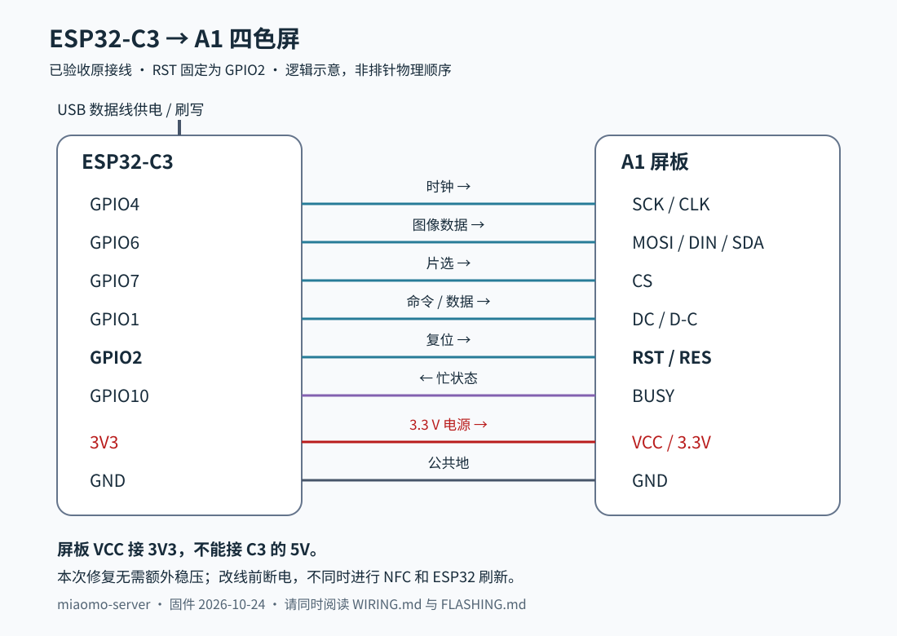

# 接线说明：ESP32-C3 + A1 四色屏

适用本发布包：768×552 图像、A1 四色屏、ESP32-C3，GPIO 定义固定。表格描述信号名称，不代表不同屏板连接器的物理脚位；先确认屏板丝印。

| ESP32-C3 | 屏板信号 | 方向 |
| --- | --- | --- |
| GPIO4 | SCK / CLK | C3 → 屏板 |
| GPIO6 | MOSI / DIN / SDA | C3 → 屏板 |
| GPIO7 | CS | C3 → 屏板 |
| GPIO1 | DC / D-C | C3 → 屏板 |
| **GPIO2** | **RST / RES** | C3 → 屏板 |
| GPIO10 | BUSY | 屏板 → C3 |
| 3V3 | VCC / 3.3V | 屏板电源 |
| GND | GND | 共地 |



本版 RST 是 GPIO2，**不要套用其他固件的 GPIO3 接法**。不需要 MISO。SDA 在这里指屏板的 SPI 数据输入，不是 I²C 接线。

## 本次验收的供电

USB 给 C3 供电，C3 的 3V3 接屏板 VCC，C3 的 GND 接屏板 GND。2026-10-24 恢复这组原接线后，用同一张照片强制刷新仍无中线；此次修复不要求额外稳压板。

```text
USB 5V ──> C3 USB 接口
               ├── 3V3 ──> 屏板 VCC / 3.3V
               └── GND ──> 屏板 GND
```

屏板的 3.3V 电源和逻辑引脚不能接 5V。改线前断电；没有确认板载电源路径时，不并联两路 3.3V 输出，也不把锂电池直接接到 3V3。

## 原 NFC 控制器

本次实机保留了原 NFC 控制器，但没有测量其电气隔离状态。ESP32 刷新时不要同时用手机 NFC 给屏板供能或发送刷新。其他屏板改装需要单独确认信号线驱动关系，不据本次验收推断所有板子都可直接并接。

## 首次检查

1. 核对 C3 型号、屏幕 A1 批次、全部八根连接线，尤其 RST2 和 BUSY10。
2. 固件设置中选择 A1。照片仍按 768×552 提供，不需改成 800×600。
3. 先显示一张照片，等待完整刷新。已验收照片的显示流程约 18.7 秒，不代表每次都固定耗时。
4. 在本地服务端点击“立即刷新”，确认相同照片也重新刷屏且完成后没有中间竖带。

